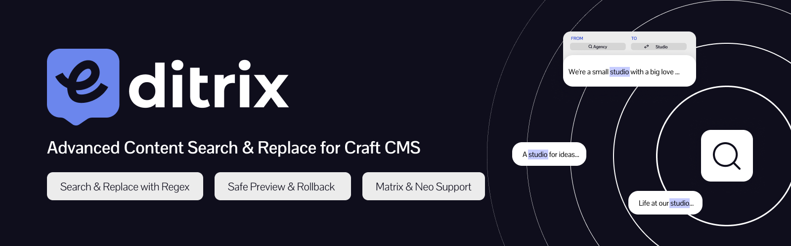

# Editrix for Craft CMS



Find text across your Craft content, preview what a replacement would change, apply it, and undo it value by value if you need to.

It searches entries, globals, Matrix and Neo blocks, and rich text fields (CKEditor, Redactor). Every replace is written to a log before any entry is saved, so a replace that is cancelled or interrupted can still be reverted. The work runs on Craft's queue, so a large site does not hit a request time limit. Editrix follows Craft's own permissions: people only find and change the entries they can already open and save in Craft.

## Requirements

- Craft CMS 4.0 or later
- PHP 8.0.2 or later

## Installation

From the root of your Craft project:

```bash
composer require brand-industry/craft-editrix
php craft plugin/install editrix
```

You can also install it from **Settings, Plugins** in the control panel. If `php craft up` later shows a project config notice after an update, see [Installation and updating](docs/installation.md).

## Quick start

1. Open **Editrix** in the control panel and choose **New Operation**.
2. Enter the text to find. Add a replacement to use Search & Replace.
3. Choose the options you need: regular expression, case, whole words.
4. Run the search and review the rows it found.
5. Open a row to see the original and proposed text, then select the rows to change and click **Replace Selected**.
6. Find the operation under **Logs & History**, where you can revert it.

## Editions

| | Standard (USD 19) | Pro (USD 99) |
| --- | :---: | :---: |
| Search entries and globals | Yes | Yes |
| Regular expressions, case, whole words | Yes | Yes |
| Preview and dry run | Yes | Yes |
| Leave single matches out of a replace | Yes | Yes |
| Search and replace link addresses in rich text | Yes | Yes |
| Logs and revert | 30 days | 90 days |
| Rows returned per search | 3,000 | 25,000 |
| Rows changed per replace | 200 | 5,000 |
| Matrix and Neo blocks | No | Yes |
| Categories, and category and tag assignment search | No | Yes |
| Several sites in one search | No | Yes |
| Limit a search to sections, entry types and fields | No | Yes |
| Preserve case | No | Yes |
| Export results and logs (CSV, JSON) | No | Yes |
| Command line | No | Yes |

Both editions can be tried for free in development and staging. See [Editions](docs/editions.md) for the details of each limit.

## Documentation

The full documentation is at [editrix.thebrandindustry.com/craft-4](https://editrix.thebrandindustry.com/craft-4/). The same pages are in the `docs` folder:

- [Installation and updating](docs/installation.md)
- [Searching](docs/searching.md)
- [Replacing](docs/replacing.md)
- [Logs and revert](docs/logs-and-revert.md)
- [Large sites and the queue](docs/large-sites.md)
- [Settings](docs/configuration.md)
- [Command line](docs/command-line.md)
- [Editions](docs/editions.md)
- [Troubleshooting](docs/troubleshooting.md)

## Support

- Issues: [GitHub Issues](https://github.com/Brand-Industry/craft-editrix/issues)
- Email: editrix-support@thebrandindustry.com

## License

Editrix is released under the [Craft License](LICENSE.md). Each license covers one production site.
